# BearPartner Bot

Uch tilli Telegram bot — taksi va yetkazib berish haydovchilari bilan hamkor kompaniya o'rtasidagi aloqa uchun.

Foydalanuvchi o'ziga qulay tilni tanlaydi (o'zbek, rus, ingliz), menyudan xizmatlar haqida ma'lumot oladi, ariza qoldiradi yoki to'ldirilgan hujjatni yuboradi. Ariza va hujjatlar admin guruhiga tushadi.

---

**Sahifa:** [abduazizbobomalikovnode.github.io/BearPartner_bot_js/](https://abduazizbobomalikovnode.github.io/BearPartner_bot_js/)

## Nima qiladi

- **Til tanlash** — o'zbek, rus va ingliz; menyu to'liq tanlangan tilda, tilni istalgan payt almashtirsa bo'ladi
- **Ma'lumot beradi** — "Bizning xizmatlar" va "BONUSLAR" bo'limlaridagi har band tegishli maqola havolasini qaytaradi
- **TAXI va DOSTAVKA** — UBER, BOLT, FREENOW hamda UBER EATS, BOLT FOOD, GLOVO uchun alohida bo'limlar
- **Yangi akkaunt** — bot to'ldirish uchun `.docx` shaklini yuboradi
- **Hamkorni o'zgartirish** — ism, elektron pochta, telefon va bank hisobi so'raladi, tasdiqlangach ariza admin guruhiga boradi
- **Savol yoki muammo** — yozilgan xabar admin guruhiga yuboriladi
- **Hujjat joylash** — to'ldirilgan hujjat (`.doc`, `.docx`, `.pdf`, 10 KB – 20 MB) admin guruhiga uzatiladi

## Qanday ishlaydi

<p align="center">
  
</p>

Bot Telegraf'ning sahna (Scene) mexanizmida qurilgan. Menyu bo'limlari `index.js`da tugma matni bo'yicha ajratiladi; ko'p qadamli ishlar — alohida sahna.

```
/start
  └─► til tanlash sahnasi (room/lang.js)
        └─► asosiy menyu (keyboard/uz | ru | eng)
              ├─► Bizning xizmatlar, BONUSLAR ─► maqola havolasi
              ├─► TAXI, DOSTAVKA
              │     ├─► yangi akkaunt ─► to'ldirish uchun .docx shakl
              │     ├─► hamkorni o'zgartirish (room/update.js) ─► admin guruhi
              │     └─► savol yoki muammo (room/comment.js) ─► admin guruhi
              └─► Hujjat joylash (room/file.js) ─► admin guruhi
```

Menyu matnlari har til uchun alohida faylda (`keyboard/`). Yangi til qo'shish uchun yangi menyu fayli yoziladi, so'ng u `index.js` va `room/` fayllaridagi `menu` ro'yxatiga hamda til tanlash tugmalariga (`room/lang.js`) qo'shiladi.

## O'rnatish

```bash
git clone https://github.com/AbduazizBobomalikovNode/BearPartner_bot_js.git
cd BearPartner_bot_js
npm install

cp .env.example .env      # BOT_TOKEN ni yozing
npm start
```

## Environment

| O'zgaruvchi | Nima uchun |
|---|---|
| `BOT_TOKEN` | [@BotFather](https://t.me/BotFather) bergan token |

Token berilmasa bot ishga tushmaydi va buni aytadi.

Admin guruhlarining ID si hozircha kodda yozilgan (`index.js`, `room/update.js`, `room/comment.js`, `room/file.js`) — botni o'z guruhingiz bilan ishlatish uchun ularni almashtiring.

## Tuzilma

```
index.js              bot, menyu bo'limlari, sahnalar ro'yxati
keyboard/
  uz.js ru.js eng.js  har til uchun menyu va matnlar
room/
  lang.js             til tanlash
  update.js           hamkorni o'zgartirish arizasi
  comment.js          savol yoki muammo
  file.js             hujjat joylash
function/             yordamchi funksiyalar
files/                bot yuboradigan shakllar va rasmlar
docs/                 landing sahifa
```

## Texnologiyalar

Node.js · Telegraf (Scenes)
